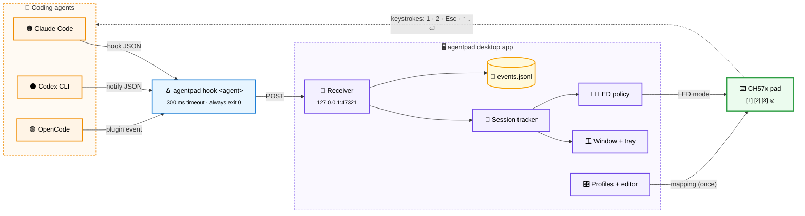
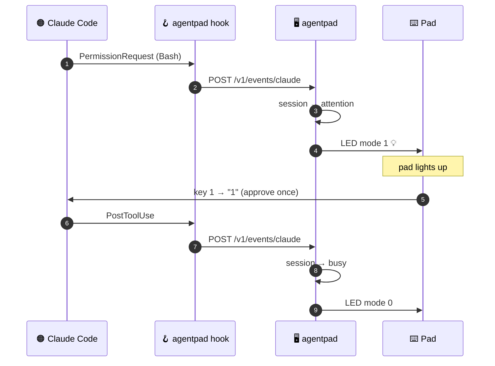
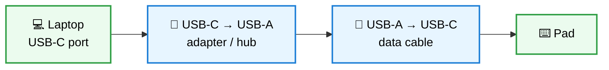

<h1 align="center">agentpad</h1>

<p align="center">
  <strong>Turn a ~6&nbsp;€ macro pad into a physical controller for AI coding agents.</strong><br/>
  Approve once · Approve always · Reject. Knob to navigate. LED lights up when an agent needs you.
</p>

<p align="center">
  <a href="https://github.com/thereisnotime/agentpad/actions/workflows/ci.yml"></a>
  
  
  
  
  
</p>

---

`agentpad` is a native Linux desktop app for the cheap **CH57x "3 keys + 1 knob"** USB macro pads sold on AliExpress.
It programs the pad with per-agent key profiles, listens to hook events from **Claude Code**, **Codex CLI** and **OpenCode**,
shows what every agent session is doing, keeps a decision log, and switches the pad LED on when an agent is waiting for your approval.

It is a single Go binary with a Fyne UI. No browser, no Electron, no Node.

## Contents

- [Features](#features)
- [How it works](#how-it-works)
- [Hardware](#hardware)
- [Install](#install)
- [Usage](#usage)
- [Agent integration](#agent-integration)
- [Default profiles](#default-profiles)
- [Development](#development)
- [Prior art](#prior-art)
- [Contributing & bugs](#contributing--bugs)
- [License](#license)

## Features

| | |
|---|---|
| 🎛️ **Program the pad** | Visual 3-key + knob editor, writes up to three layers to the pad. The mapping lives on the pad, so it then works on any computer without agentpad. |
| 🤖 **Per-agent profiles** | Built-in presets for Claude Code, Codex CLI, OpenCode and media keys. Every key is editable and saved per user. |
| 🚦 **LED follows your agents** | When any session waits for a permission prompt, the pad lights up. Change-only and rate-limited to spare the device. |
| 📋 **Live sessions** | Every running agent session with its directory, state and last tool, updated in real time. |
| 📜 **Decision log** | Every hook event appended to a JSON Lines file for later review. |
| 🔌 **Copy-paste setup** | Ready-made hook snippets for each agent and the udev rule. agentpad never edits your agent configs itself. |
| 🖥️ **Tray icon** | Shows aggregate state (idle / busy / needs attention). Closing the window keeps it running. |
| 🔒 **Local only** | The event receiver listens on `127.0.0.1` only. Hook calls time out in 300&nbsp;ms and always exit 0, so they can never block an agent. |

## How it works



### Approval flow



1. agentpad writes a key profile to the pad once. From then on the pad is a plain USB keyboard sending e.g. `1`, `2`, `Esc`.
2. Agent hooks call `agentpad hook <agent>`, which forwards the event to the running app.
3. The app tracks sessions. If any session waits for you, it switches the pad LED on and turns the tray icon to attention.

## Hardware

Any CH57x-based pad with USB ID `1189:8890`, `1189:8840` or `1189:8842`. The tested target is the 3 keys + 1 knob variant.

> [!WARNING]
> **Pad dead on a USB-C laptop? It's probably fine.** To save a few cents, many of these pads leave out the two
> 5.1&nbsp;kΩ "CC" resistors on their USB-C socket. A USB-C host only switches power on when it sees those resistors,
> so on a USB-C only laptop or phone the pad gets **no power at all**: no LED, nothing in `lsusb`, an inline USB meter stays dark.
> USB-A ports always supply power, so they are not affected.

### Fix: go through USB-A



| Setup | Works? |
|---|---|
| USB-C laptop → **USB-C → USB-C cable** → pad | ❌ no power (missing resistors) |
| USB-C laptop → **USB-C → USB-A adapter** → **USB-A → USB-C cable** → pad | ✅ the adapter tells the laptop to supply power |
| USB-A port → **USB-A → USB-C cable** → pad | ✅ |
| Solder 5.1&nbsp;kΩ from CC1 and CC2 to GND inside the pad | ✅ permanent fix, any cable works |

Also check the cable: the one bundled with these pads is often **charge-only** (no data wires).

## Install

### Requirements

- Linux (X11 or XWayland)
- [`ch57x-keyboard-tool`](https://github.com/kriomant/ch57x-keyboard-tool) on `PATH` (device backend for the POC)
- A udev rule so your user can program the pad

```bash
git clone git@github.com:thereisnotime/agentpad.git && cd agentpad
just tool-install      # ch57x-keyboard-tool -> ~/.local/bin
just udev-install      # /etc/udev/rules.d/50-agentpad.rules (sudo)
just install           # agentpad -> ~/.local/bin
```

### Build dependencies

Go 1.27 and [just](https://github.com/casey/just) (pinned in `.tool-versions`), plus the Fyne C dependencies:

```bash
# Fedora
sudo dnf install gcc libXcursor-devel libXrandr-devel libXinerama-devel libXi-devel libXxf86vm-devel mesa-libGL-devel
# Debian / Ubuntu
sudo apt install gcc libgl1-mesa-dev xorg-dev libxkbcommon-dev
```

## Usage

```bash
agentpad                  # start the desktop app
agentpad hook claude      # forward a hook payload (used by agent configs)
agentpad version
```

In the app:

1. **Pad**: check that the pad is detected and writable.
2. **Profiles**: pick a profile, adjust keys if needed, click **Apply**.
3. **Setup**: copy the hook snippet for your agent into its config.
4. Work as usual. When an agent asks for permission the pad lights up. Press `1` / `2` / `3`.

## Agent integration

The **Setup** tab generates these for you. They are shown here for reference.

<details>
<summary><strong>Claude Code</strong> · <code>~/.claude/settings.json</code></summary>

```json
{
  "hooks": {
    "SessionStart":     [{ "hooks": [{ "type": "command", "command": "agentpad hook claude" }] }],
    "UserPromptSubmit": [{ "hooks": [{ "type": "command", "command": "agentpad hook claude" }] }],
    "Notification":     [{ "hooks": [{ "type": "command", "command": "agentpad hook claude" }] }],
    "PermissionRequest":[{ "hooks": [{ "type": "command", "command": "agentpad hook claude" }] }],
    "PostToolUse":      [{ "hooks": [{ "type": "command", "command": "agentpad hook claude" }] }],
    "Stop":             [{ "hooks": [{ "type": "command", "command": "agentpad hook claude" }] }],
    "SessionEnd":       [{ "hooks": [{ "type": "command", "command": "agentpad hook claude" }] }]
  }
}
```
</details>

<details>
<summary><strong>Codex CLI</strong> · <code>~/.codex/config.toml</code></summary>

```toml
notify = ["agentpad", "hook", "codex"]
```

Codex `notify` only reports finished turns, so Codex sessions show busy/idle but not pending approvals yet. Codex's newer lifecycle hooks will close that gap.
</details>

<details>
<summary><strong>OpenCode</strong> · <code>~/.config/opencode/plugins/agentpad.js</code></summary>

A small plugin that forwards session and permission events to `agentpad hook opencode`. Copy it from the Setup tab.
</details>

## Default profiles

| Profile | Key 1 | Key 2 | Key 3 | Knob ⟲ / press / ⟳ |
|---|---|---|---|---|
| `claude-code` | `1` approve | `2` always | `Esc` reject | `↑` / `Enter` / `↓` |
| `codex` | `y` approve | `a` always | `Esc` reject | `↑` / `Enter` / `↓` |
| `opencode` | `Enter` once | `a` always | `Esc` reject | `↑` / `Enter` / `↓` |
| `media` | prev | play/pause | next | vol − / mute / vol + |

Prompt shortcuts change between agent versions. Adjust them in the editor if your version differs.

## Development

```bash
just            # list recipes
just ci         # lint + test + build
just run        # build and start the app
just fake-event # send a fake Claude permission prompt to the running app
just log        # tail the event log
```

```
cmd/agentpad        entry point, `hook` subcommand
internal/pad        USB detection, ch57x writer, LED controller
internal/profile    profiles, persistence, mapping YAML
internal/events     normalisation, session tracker, log, HTTP receiver
internal/hook       hook forwarder
internal/setup      agent snippets and udev rule
internal/ui         Fyne desktop UI
openspec/           specs and change proposals (OpenSpec)
```

Specs live in [`openspec/`](openspec/) and are managed with [OpenSpec](https://openspec.dev).

## Prior art

agentpad combines ideas from these projects:

- [kriomant/ch57x-keyboard-tool](https://github.com/kriomant/ch57x-keyboard-tool): the reverse-engineered pad protocol agentpad relies on
- [blairhudson/clawkeys](https://github.com/blairhudson/clawkeys): the same pad as an OpenCode approve/reject controller, with profiles
- [etalli/Gavel](https://github.com/etalli/Gavel): Claude Code permission buttons, hook-driven LEDs and a decision log
- [cha978rlie/CodexPad](https://github.com/cha978rlie/CodexPad): 3-key pad companion for Codex, LED as unread indicator
- [puritysb/AgentDeck](https://github.com/puritysb/AgentDeck): multi-agent dashboards and physical controls

## Contributing & bugs

Found a bug? Use **About → Report a bug** in the app (it pre-fills version, OS and pad), or open a
[bug report](https://github.com/thereisnotime/agentpad/issues/new?template=bug_report.yml).
Ideas go to [feature requests](https://github.com/thereisnotime/agentpad/issues/new?template=feature_request.yml).

## License

[MIT](LICENSE)
