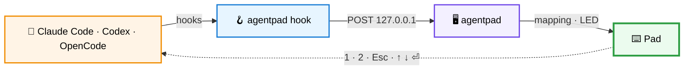

<h1 align="center">agentpad</h1>

<p align="center">
  <strong>Turn a ~6&nbsp;€ macro pad into a physical controller for AI coding agents.</strong><br/>
  Approve once · Approve always · Reject. Knob to navigate. LED lights up when an agent needs you.
</p>

<p align="center">
  <a href="https://github.com/thereisnotime/agentpad/actions/workflows/ci.yml"></a>
  
  
  
  
  
</p>

<p align="center">
  <a href="#quick-start">Quick start</a> ·
  <a href="docs/README.md">Docs</a> ·
  <a href="docs/hardware.md">Hardware</a> ·
  <a href="docs/agents.md">Agent setup</a> ·
  <a href="https://github.com/thereisnotime/agentpad/issues/new?template=bug_report.yml">Report a bug</a>
</p>

---

`agentpad` is a native Linux desktop app for the cheap **CH57x "3 keys + 1 knob"** USB macro pads.
It programs the pad with per-agent key profiles, listens to **Claude Code**, **Codex CLI** and **OpenCode** hooks,
shows what every agent session is doing, and lights the pad up when an agent is waiting for you.

One Go binary with a native Fyne UI. No browser, no Electron, no Node.

## Highlights

| | |
|---|---|
| 🎛️ **Program the pad** | Visual editor for the 3 keys + knob. The mapping lives on the pad, so it works anywhere afterwards. |
| 🔄 **Any orientation** | Horizontal or vertical, knob on any side. Keys stay in the order you see them. |
| 🤖 **Per-agent profiles** | Presets for Claude Code, Codex, OpenCode and media keys, all editable. |
| 🚦 **LED follows your agents** | The pad lights up when a session waits for a permission decision. |
| 🌈 **LED control** | Effects per model, colours on boards that support them. |
| 📋 **Live sessions & log** | Every agent session with state, directory and last tool, plus a JSONL event log. |
| 🖥️ **Tray** | Idle / busy / needs-attention at a glance. |
| 🔒 **Local & safe** | Loopback-only receiver; hooks time out in 300&nbsp;ms and never block an agent. |

**Coming next:** per-app profiles on X11 and KDE Wayland.

## How it works



1. agentpad writes a profile to the pad once. From then on the pad is a plain USB keyboard (`1`, `2`, `Esc`, …).
2. Agent hooks report what's happening to the running app.
3. When an agent asks for permission, the pad and tray light up. Press a key to answer.

More detail: [Architecture](docs/architecture.md).

## Quick start

> [!IMPORTANT]
> **Pad dead on a USB-C laptop?** Many of these pads lack the resistors USB-C needs to get power.
> Connect it through a **USB-C → USB-A adapter + USB-A → USB-C cable**. [Why and other fixes →](docs/hardware.md#usb-c-power-quirk)

```bash
git clone git@github.com:thereisnotime/agentpad.git && cd agentpad
just tool-install    # pad programming backend → ~/.local/bin
just udev-install    # lets your user program the pad (sudo)
just install         # agentpad → ~/.local/bin
agentpad
```

Then in the app:

1. **Pad**: check the pad is detected.
2. **Profiles**: pick a profile, rotate the pad to match your desk, **Apply to pad**.
3. **Setup**: copy the hook snippet for your agent ([details](docs/agents.md)).

Build requirements (Go 1.27, just, Fyne's C headers) are in [Development](docs/development.md).

## Documentation

| Guide | |
|---|---|
| [Hardware](docs/hardware.md) | Supported pads, USB-C quirk, LEDs per model, orientation, udev |
| [Agent integration](docs/agents.md) | Claude Code, Codex CLI, OpenCode hooks and what each event means |
| [Profiles](docs/profiles.md) | Built-in profiles, action syntax, layers, storage |
| [Gestures](docs/gestures.md) | Hold, double-tap, press+rotate, chords |
| [Attention jump](docs/attention-jump.md) | Jump to the waiting agent's tab / pane |
| [Architecture](docs/architecture.md) | Components, event model, receiver API, files |
| [Development](docs/development.md) | X11 / Wayland builds, just recipes, tests, specs, CI |
| [Troubleshooting](docs/troubleshooting.md) | Common problems and fixes |

## Prior art

agentpad combines ideas from:

- [kriomant/ch57x-keyboard-tool](https://github.com/kriomant/ch57x-keyboard-tool): the reverse-engineered pad protocol agentpad relies on
- [blairhudson/clawkeys](https://github.com/blairhudson/clawkeys): the same pad as an OpenCode approve/reject controller
- [etalli/Gavel](https://github.com/etalli/Gavel): Claude Code permission buttons, hook-driven LEDs, decision log
- [cha978rlie/CodexPad](https://github.com/cha978rlie/CodexPad): 3-key pad companion for Codex
- [puritysb/AgentDeck](https://github.com/puritysb/AgentDeck): multi-agent dashboards and physical controls

## Contributing & bugs

Use **About → Report a bug** in the app (pre-fills version, OS and pad), or open a
[bug report](https://github.com/thereisnotime/agentpad/issues/new?template=bug_report.yml) /
[feature request](https://github.com/thereisnotime/agentpad/issues/new?template=feature_request.yml).
Development setup: [docs/development.md](docs/development.md).

## License

[MIT](LICENSE)
