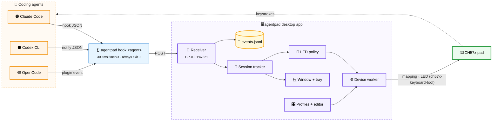
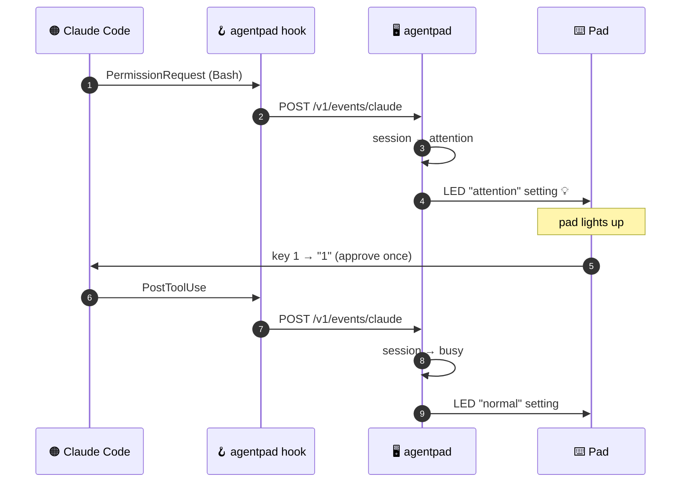

# Architecture

[← Docs index](README.md)

## Components



## Approval flow



## Event model

Every payload is normalised to an event `{time, agent, session_id, kind, name, tool, cwd, message, raw}`.

| Kind | Session state |
|---|---|
| `session_start` | idle |
| `prompt` | busy |
| `tool_pending` | **attention** |
| `tool_done` | busy |
| `waiting_input` / `idle` | idle |
| `session_end` | removed |
| `other` | unchanged (logged only) |

Aggregate state: **attention** if any session waits for a decision, else **busy** if any works, else **idle**.
It drives the tray icon and the LED policy. Sessions without events for 30 minutes are pruned.

## Receiver API

Loopback only (`127.0.0.1:47321`, non-loopback addresses are refused).

| Method | Path | Body | Response |
|---|---|---|---|
| `POST` | `/v1/events/{claude\|codex\|opencode}` | raw agent payload (≤ 1&nbsp;MiB) | `204` |
| `GET` | `/v1/health` | – | `200 ok` |

## Files

| Path | Content |
|---|---|
| `~/.config/agentpad/profiles/*.yaml` | your profile overrides |
| `~/.local/state/agentpad/events.jsonl` | append-only event log |
| Fyne preferences (`~/.config/fyne/dev.thereisnotime.agentpad/`) | orientation, LED settings, UI state |

## Packages

```text
cmd/agentpad        entry point, `hook` subcommand
internal/config     paths and constants
internal/pad        USB detection, ch57x writer, LED capabilities, LED controller
internal/profile    profiles, validation, store, mapping YAML, orientation
internal/events     normalisation, session tracker, log, HTTP receiver
internal/hook       hook forwarder
internal/setup      agent snippets, udev rule
internal/ui         Fyne desktop UI (only package importing Fyne, besides cmd)
```
