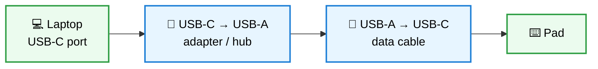

# Hardware

[← Docs index](README.md)

- [Supported pads](#supported-pads)
- [USB-C power quirk](#usb-c-power-quirk)
- [LEDs](#leds)
- [Orientation](#orientation)
- [Permissions (udev)](#permissions-udev)
- [Device backend](#device-backend)

## Supported pads

Cheap CH57x-based macro pads sold on AliExpress/Temu/Amazon under many names.

| USB ID | Typical layout | Status |
|---|---|---|
| `1189:8890` | 3 keys + 1 knob | ✅ primary target, tested |
| `1189:8840` | various (keys + knobs) | ⚠️ supported by the backend, LED colours affected by an upstream bug |
| `1189:8842` | various (keys + knobs) | ⚠️ supported by the backend, untested here |

Check yours with `just detect` or `lsusb -d 1189:`.

The mapping is stored **on the pad**. Once programmed it is a plain USB keyboard and works on any computer, with or without agentpad.

## USB-C power quirk

> [!WARNING]
> **Pad dead on a USB-C laptop? It's probably fine.** Many of these pads leave out the two 5.1&nbsp;kΩ "CC" pull-down
> resistors on their USB-C socket. A USB-C host only switches power on when it sees them, so on a USB-C-only laptop or
> phone the pad gets **no power at all**: no LED, nothing in `lsusb`, an inline USB meter stays dark.
> USB-A ports always supply power and are not affected.

### Fix: go through USB-A



| Setup | Works? |
|---|---|
| USB-C laptop → **USB-C → USB-C cable** → pad | ❌ no power (missing resistors) |
| USB-C laptop → **USB-C → USB-A adapter** → **USB-A → USB-C cable** → pad | ✅ the adapter tells the laptop to supply power |
| USB-A port → **USB-A → USB-C cable** → pad | ✅ |
| Solder 5.1&nbsp;kΩ from CC1 and CC2 to GND inside the pad | ✅ permanent fix, any cable works |

Also check the cable: the one bundled with these pads is often **charge-only** (no data wires).

**How to tell:** with an inline USB meter, a missing-resistor pad shows the meter **off** on USB-C→C, and **on** with a C→A adapter.
A dead pad shows the meter on but ~0&nbsp;mA on any port.

## LEDs

What you can control depends on the model:

| Model | Control | Colours |
|---|---|---|
| `8890` | built-in effect **modes** by index (`0` = off), global for the pad | ❌ firmware has no colour control |
| `8840` / `8842` | per layer (1–3): `off`, `backlight`, `shock`, `shock2`, `press` | red, orange, yellow, green, cyan, blue, purple (+ white for backlight) |

- The `8890` firmware is undocumented; effect labels in the app are editable. Run `just led-probe` to cycle the modes and see what each does on your unit.
- `8840` LED colours are affected by [ch57x-keyboard-tool#180](https://github.com/kriomant/ch57x-keyboard-tool/issues/180) in v1.7.0 (fixed on master, unreleased).
- agentpad only writes when the LED setting changes and at most once every 2&nbsp;s, to spare the device.

## Orientation

The pad can sit four ways. Set it in the profile editor (rotate buttons); profiles keep the order **as you see the keys**
(left→right, or top→bottom when vertical), so "approve" stays the first key you see.

| Orientation | Looks like | Knob |
|---|---|---|
| `normal` | `[1] [2] [3] ◎` | right |
| `upsidedown` | `◎ [1] [2] [3]` | left |
| `clockwise` | keys stacked, knob below | bottom |
| `counterclockwise` | knob on top, keys below | top |

## Permissions (udev)

Programming the pad needs access to the USB device. Install the rule once:

```bash
just udev-install   # writes /etc/udev/rules.d/50-agentpad.rules, reloads udev
```

```text
SUBSYSTEM=="usb", ATTR{idVendor}=="1189", ATTR{idProduct}=="8890|8840|8842", TAG+="uaccess"
```

Replug the pad afterwards. Gesture mode adds rules for the pad's input devices and `/dev/uinput`; see [Gestures](gestures.md).

## Device backend

For now agentpad drives the pad through [`ch57x-keyboard-tool`](https://github.com/kriomant/ch57x-keyboard-tool)
(the reverse-engineered protocol). Install it with `just tool-install` (v1.7.0 to `~/.local/bin`).
A native Go backend can replace it later without UI changes.
